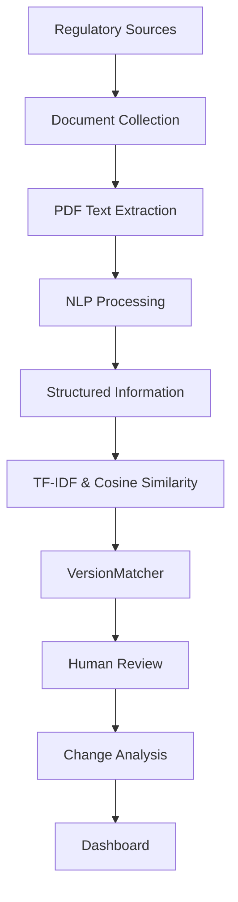

# 🏛️ GovWatch
### AI-Powered Regulatory Intelligence & Compliance Monitoring

<p align="center">
  <strong>Turning regulatory documents into actionable intelligence.</strong>
</p>

<p align="center">
  
  
  
  
  
  
</p>

---

## 📌 Overview

Regulatory authorities continuously publish circulars, notifications, guidelines, and policy amendments. Tracking these updates manually can be time-consuming and makes it difficult to identify relationships between regulatory documents.

**GovWatch** is an AI-powered regulatory intelligence platform designed to automate document processing, extract meaningful information, discover potentially related policies, and support regulatory change monitoring through a centralized interface.

It transforms unstructured regulatory publications into structured, searchable intelligence.

## ✨ Key Features

- 📄 **Document Processing** – Extracts text and information from regulatory PDF documents.
- 🧠 **NLP Intelligence** – Uses Natural Language Processing for entity, date, keyword, and topic extraction.
- 🔍 **Document Similarity** – Applies TF-IDF and cosine similarity to discover potentially related documents.
- 🔗 **Policy Relationship Discovery** – Uses multi-signal matching to identify possible relationships between regulatory publications.
- 🔄 **Change Analysis** – Supports comparison of confirmed document-version relationships.
- 📊 **Centralized Dashboard** – Provides a unified interface for regulatory intelligence and document review.
- 👤 **Human Review** – Allows suggested relationships to be reviewed instead of treating similarity as legal confirmation.

## 🏗️ System Architecture



## ⚙️ Technology Stack

| Component | Technologies |
|---|---|
| Backend | Python, FastAPI |
| Frontend | React, TypeScript, Vite |
| Database | SQLite |
| NLP | spaCy |
| Text Processing | PDF extraction, preprocessing |
| Similarity | TF-IDF, Cosine Similarity |
| Relationship Matching | VersionMatcher |

## 🔄 How It Works

1. **Collect:** Regulatory documents are collected from supported sources.
2. **Extract:** PDF content is converted into machine-readable text.
3. **Analyze:** NLP extracts entities, dates, keywords, and topics.
4. **Compare:** TF-IDF and cosine similarity identify potentially related documents.
5. **Match:** VersionMatcher evaluates multiple signals to discover possible policy relationships.
6. **Review:** Suggested relationships are presented for human verification.
7. **Monitor:** Confirmed document versions can be compared for regulatory changes.

## 🚀 Getting Started

### Prerequisites

- Python 3.x
- Node.js and npm
- Git

### Clone the Repository

```bash
git clone https://github.com/bhooshan16/GovWatch.git
cd GovWatch
```

### Backend Setup

```bash
python -m venv .venv
```

Activate the environment:

**Windows PowerShell**
```powershell
.\.venv\Scripts\Activate.ps1
```

Install dependencies:

```bash
pip install -r requirements.txt
```

Start the backend using the project's configured FastAPI entry point.

### Frontend Setup

```bash
cd web
npm install
npm run dev
```

## 📊 Project Scope

GovWatch currently focuses primarily on RBI regulatory publications. Additional regulatory source integrations are at different stages of development.

The system treats similarity results as candidate relationships, not verified legal relationships. Change analysis is intended for confirmed document-version pairs.

## 🔮 Future Enhancements

- Broader regulatory authority integrations.
- Improved semantic document search.
- Advanced policy relationship discovery.
- Automated regulatory update notifications.
- Enhanced compliance tracking and reporting.
- More comprehensive evaluation using verified reference datasets.

## 🤝 Contributing

Contributions, suggestions, and improvements are welcome. Feel free to fork the repository and submit a pull request.

## 📄 License

This project is licensed under the MIT License. See the [LICENSE](LICENSE) file for details.

---

<p align="center">
  <strong>GovWatch — Making Regulatory Intelligence Smarter.</strong>
</p>
